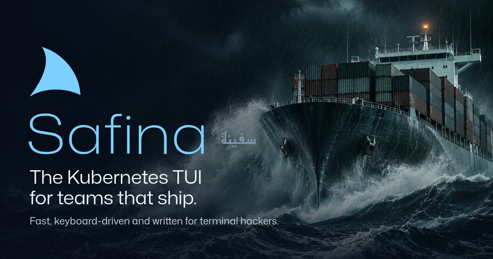
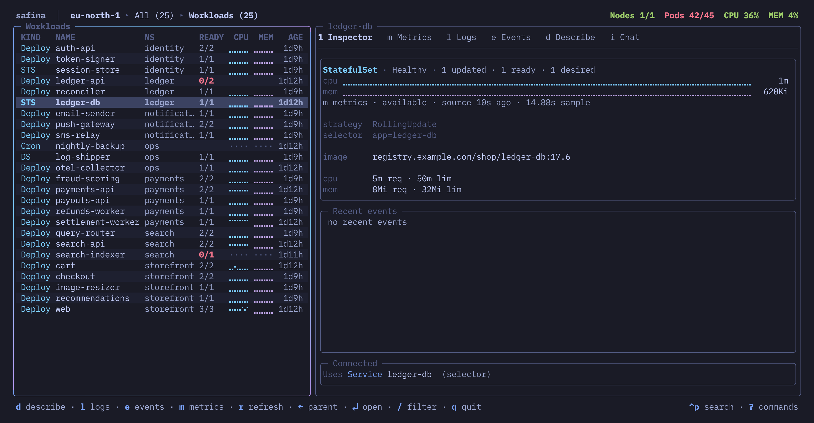
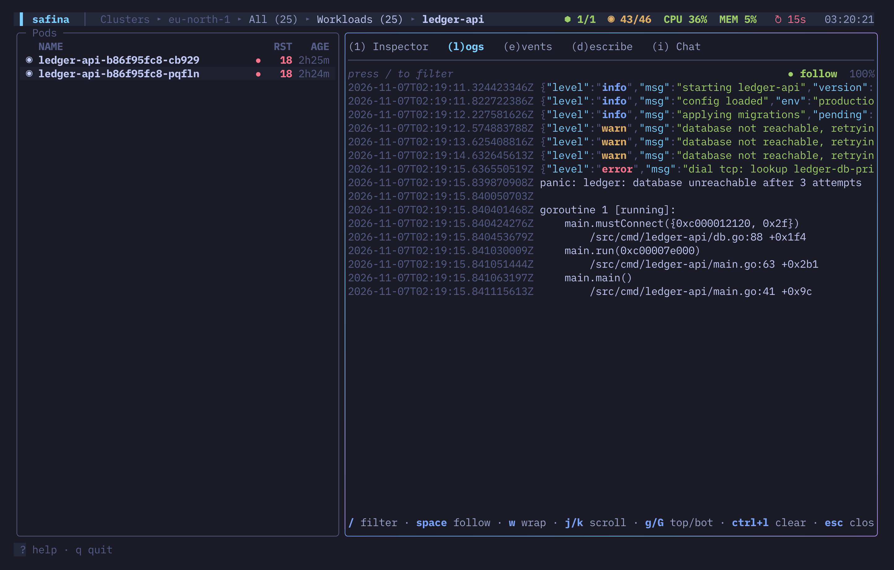
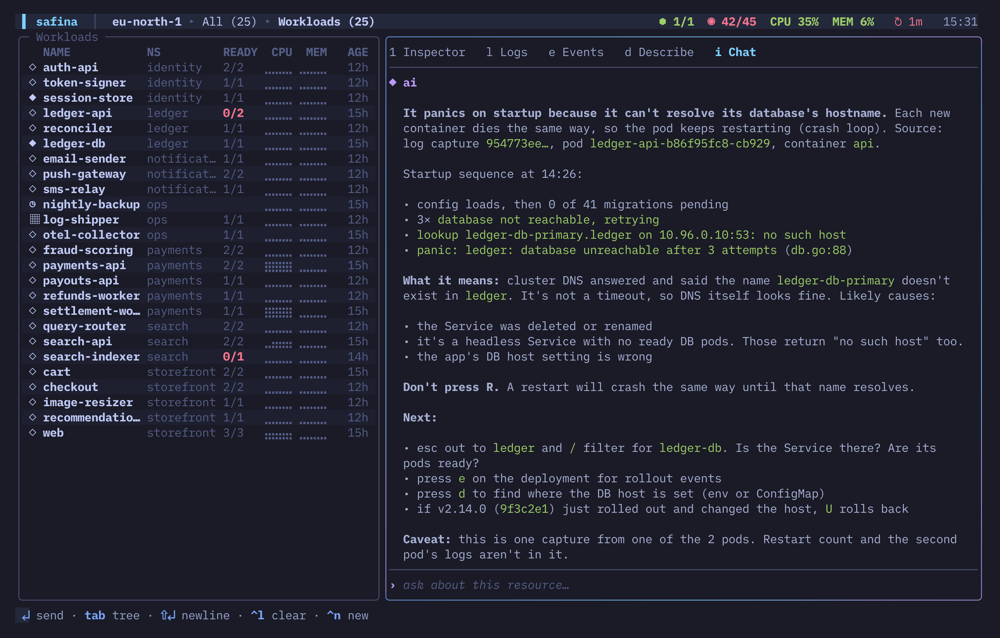
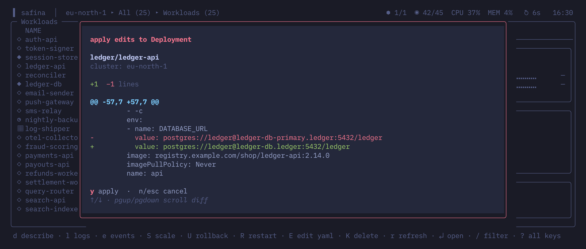
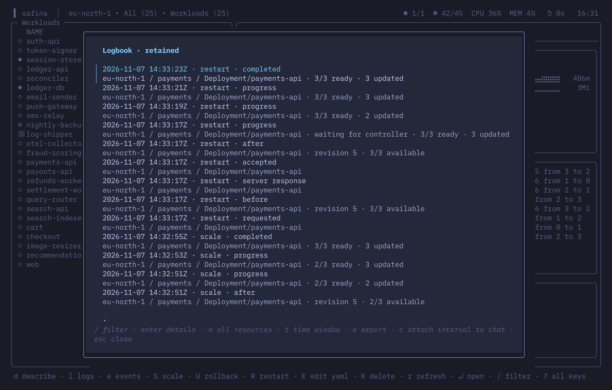

<p align="center">
  <a href="https://safina.run">
    
  </a>
</p>

<p align="center">
  Fast, keyboard-driven and written for terminal hackers.<br>
  A single Go binary on lazy client-go informers, with session history in SQLite<br>
  and an MCP server for your agent.
</p>

<p align="center">
  <a href="https://safina.run"><b>safina.run</b></a> ·
  <a href="#install">Install</a> ·
  <a href="docs/keybindings.md">Keys</a> ·
  <a href="docs/">Docs</a>
</p>

<p align="center">
  <a href="https://github.com/YunusAndreasson/safina/releases/latest"></a>
  <a href="https://github.com/YunusAndreasson/safina/actions/workflows/lint.yml"></a>
  <a href="LICENSE"></a>
</p>

<br>



## Install

```sh
curl -fsSL https://safina.run/install.sh | sh
```

Linux on x86-64 or ARM64, with glibc 2.34 or newer. The
[script](site/public/install.sh) checks the archive against the release's
SHA-256 sums and puts `safina` in `~/.local/bin` (`SAFINA_INSTALL_DIR` and
`SAFINA_VERSION` change where and which). The archives are on the
[releases page](https://github.com/YunusAndreasson/safina/releases); on macOS,
[build from source](docs/development.md#build-from-source).

Run `safina`. It reads your kubeconfig, asks which cluster, and `?` shows the
keys.

## Features

- **Jump to what's broken.** `n` goes to the next failing workload; `l`, `e`,
  `h` and `m` open its logs, events, hot pods and CPU and memory charts.
- **Chat.** Press `i` and ask what's wrong. The model gets the resource you're
  on and what you've already tried, and answers with keys to press. It can't
  press them itself.
- **Barbarossa mode.** Lowercase reads, uppercase writes: every key that
  changes the cluster needs Shift, and an edit shows its diff before it's
  applied.
- **Rollout watch.** A scale, restart or edit is followed until its pods are
  ready.
- **Logbook.** The logs and events you read and every write you made, kept on
  your machine with secrets redacted, and exportable as a postmortem timeline.
- **Nothing in the cluster.** No agent, operator or CRDs. It uses the
  kubeconfig you already have and can only do what your RBAC allows.

<table>
  <tr>
    <td width="50%"></td>
    <td width="50%"></td>
  </tr>
  <tr>
    <td align="center"><sub><b>Logs</b>, a crash caught live</sub></td>
    <td align="center"><sub><b>Chat</b>, reading those logs</sub></td>
  </tr>
  <tr>
    <td width="50%"></td>
    <td width="50%"></td>
  </tr>
  <tr>
    <td align="center"><sub><b>Barbarossa mode</b>, the fix as a diff</sub></td>
    <td align="center"><sub><b>Logbook</b>, the edit through to 2/2 ready</sub></td>
  </tr>
</table>

## Docs

The manual lives in [`docs/`](docs/):

- [Using safina](docs/using.md): flags, features in detail, resource charts,
  terminal setup
- [Keybindings](docs/keybindings.md)
- [The Logbook, chat and investigations](docs/logbook.md)
- [Development](docs/development.md): building, checks, project layout
- [The website](site/README.md)

## Under the hood

- [Bubble Tea](https://github.com/charmbracelet/bubbletea),
  [Bubbles](https://github.com/charmbracelet/bubbles) and
  [Lip Gloss](https://github.com/charmbracelet/lipgloss) for the TUI
- [client-go](https://github.com/kubernetes/client-go) for Kubernetes
- [libghostty](https://github.com/ghostty-org/ghostty) for the embedded shell's
  terminal
- [modernc.org/sqlite](https://gitlab.com/cznic/sqlite) for the Logbook, in
  pure Go
- [MCP Go SDK](https://github.com/modelcontextprotocol/go-sdk) for the agent
  server
- [ntcharts](https://github.com/NimbleMarkets/ntcharts) for the resource charts
- [Cobra](https://github.com/spf13/cobra) for the CLI

## License

[MIT](LICENSE). Safina (سفينة) is Arabic for ship.
